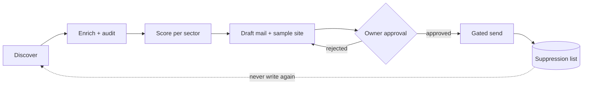

# NEIT HQ

**A human-approved lead and outreach operations panel for a small studio.** It finds local businesses, audits their web presence, scores them, drafts personalised outreach and a sample site, and then stops: nothing is sent or published until the owner approves it.

> **Status: in development.** This repository is a showcase. The source code is private and is not published here. Everything shown below uses synthetic demo data.

Cover: brand illustration, not a screenshot of the panel.

By [NEIT](https://nivyxa.com) (Nivyxa), digital creative studio. Category: automation.

## What it does

| Stage | What happens |
|---|---|
| **Discover** | Finds businesses for a location and sector from public data providers and stores them as leads. |
| **Enrich and audit** | Collects contact details and inspects each business's web presence; findings feed a score. |
| **Score** | Weighted signals, then a percentile *within the sector*: the top 20% are HOT, the next 30% WARM. Weights live in a config file, not in code. |
| **Draft** | Writes a personalised outreach mail and can build a small sample site for the lead. Drafts only. |
| **Approve** | The owner reviews the exact version of each mail. Approval is tied to a content digest, so editing a mail invalidates it. |
| **Send (gated)** | Sending happens only after approval, from the frozen approved copy. |
| **Panel** | Dashboard with a conversion funnel, customers, outbox, calendar, messages, a site studio and settings. |

## Design principles

- **Human in the loop.** Agents prepare; the owner decides. Sending, publishing, price changes and settings changes are never an agent's action.
- **Everything risky is off by default.** Live searching, live sending, publishing and mailbox reading each sit behind a separate switch that starts disabled and is recorded in an audit log when toggled.
- **Opt-out is respected by construction.** A suppression list blocks any address that asked not to be contacted, and a second send to the same address is blocked.
- **Untrusted input is data, not instructions.** Text from websites, mail bodies and attachments is escaped and never treated as a command.
- **Test mode is isolated.** Trial mails can only reach addresses on a small owner-managed test list and are clearly marked as tests.
- **Roles.** Two roles: an owner role that can act, and a read-only viewer role.
- **Tenant isolation.** Data is scoped per tenant; one tenant cannot read another's records.
- **Backups with verification.** Scheduled backups are restored into a clean folder and integrity-checked.

## Tech

- **Backend:** Python, FastAPI; SQLite plus JSON stores; a command-line entry point for the pipeline jobs.
- **Agents:** a small registry of specialised, offline agents (routing, site planning, QA checks, research records, sales drafts, finance reports, passive security checks, staging plans). They run against a mock model adapter in this build.
- **Frontend:** Next.js (App Router, static export), TypeScript, react-query. A Tauri shell wraps it as a desktop app.
- **Quality:** characterization tests that replay scripted inputs against golden outputs, plus unit tests on both sides, lint and type checks in CI.

## What is not claimed

No performance figures, lead counts, conversion rates or customer results are published here, because none have been measured on real operations yet. The desktop build and live third-party integrations have not been verified end to end.

## Screenshots

<!-- Add synthetic-data screenshots to docs/screenshots/ and link them here. Never include real businesses, e-mail addresses or inbox contents. -->

## Contact

[nivyxa.com](https://nivyxa.com)

© NEIT. All rights reserved. This repository contains documentation only; no licence to the source code is granted.

---

# NEIT HQ (Türkçe)

**Küçük bir stüdyo için insan onaylı lead ve iletişim yönetim paneli.** Yerel işletmeleri bulur, web varlığını denetler, puanlar, kişiselleştirilmiş teklif maili ve örnek site taslağı hazırlar, sonra durur: sahibi onaylamadan hiçbir şey gönderilmez ya da yayınlanmaz.

> **Durum: geliştirme aşamasında.** Bu depo yalnızca bir vitrindir. Kaynak kod özeldir ve burada yayımlanmaz. Gösterilen her şey sentetik demo verisiyle hazırlanmıştır.

## Ne yapar

- **Keşif:** Konum ve sektöre göre açık veri sağlayıcılarından işletme bulur, lead olarak kaydeder.
- **Zenginleştirme ve denetim:** İletişim bilgisini toplar, web varlığını inceler; bulgular puana yansır.
- **Puanlama:** Ağırlıklı sinyaller, ardından *sektör içi yüzdelik*: üst %20 HOT, sonraki %30 WARM. Ağırlıklar kodda değil, yapılandırma dosyasındadır.
- **Taslak:** Kişiselleştirilmiş mail ve istenirse küçük bir örnek site hazırlar. Yalnızca taslak.
- **Onay:** Sahibi her mailin tam sürümünü onaylar. Onay içerik özetine bağlıdır; mail değişirse onay geçersiz olur.
- **Kapılı gönderim:** Gönderim yalnızca onaydan sonra, onaylanmış dondurulmuş kopyadan yapılır.
- **Panel:** Dönüşüm hunisi, müşteriler, gönderim kutusu, takvim, mesajlar, site stüdyosu ve ayarlar.

## Tasarım ilkeleri

- **İnsan döngüde.** Ajanlar hazırlar, sahibi karar verir. Gönderme, yayınlama ve ayar değişikliği hiçbir zaman ajan eylemi değildir.
- **Riskli her şey varsayılan olarak kapalı.** Canlı arama, canlı gönderim, yayın ve posta kutusu okuma ayrı anahtarlarla kapalı başlar; açıldığında denetim kaydına yazılır.
- **Ret listesi yapısal olarak korunur.** "Bir daha yazma" diyen adrese gönderim engellenir; aynı adrese ikinci gönderim de engellenir.
- **Dışarıdan gelen metin veridir, talimat değildir.**
- **Rol ve kiracı ayrımı:** yazabilen sahip rolü ve salt okunur izleyici rolü; veriler kiracıya göre ayrılır.
- **Doğrulanan yedekler.**

## İddia edilmeyenler

Gerçek operasyonda ölçülmediği için performans, lead sayısı, dönüşüm oranı veya müşteri sonucu paylaşılmaz. Masaüstü sürümü ve canlı üçüncü taraf entegrasyonları uçtan uca doğrulanmadı.

İletişim: [nivyxa.com](https://nivyxa.com)

© NEIT. Tüm hakları saklıdır. Bu depo yalnızca dokümantasyon içerir; kaynak koda lisans verilmez.
